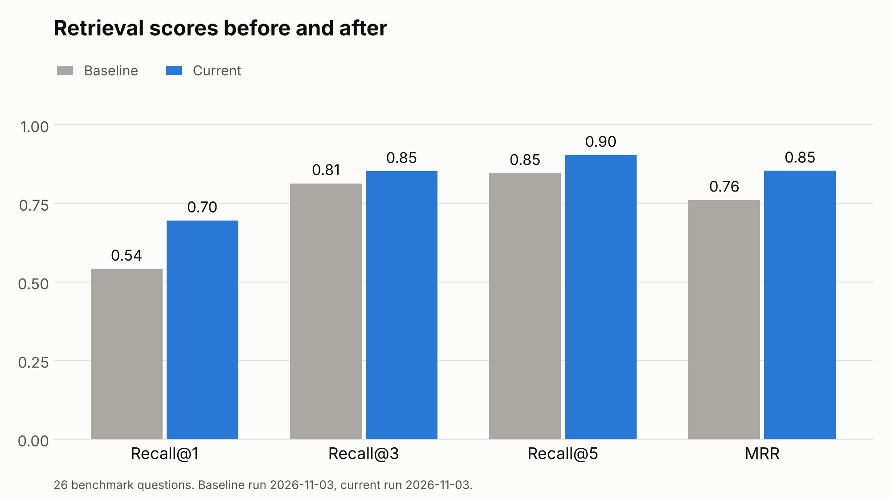
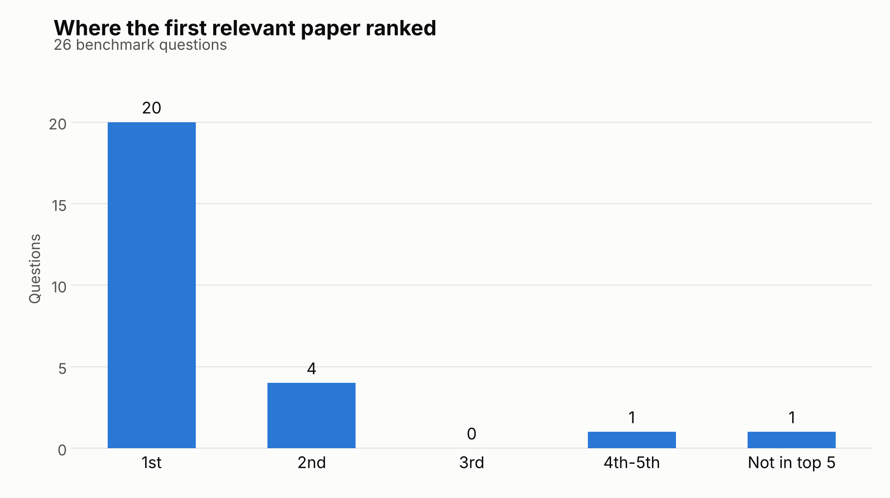

# AI Research Intelligence Agent for Business Insight Translation

A retrieval-augmented generation (RAG) system over public AI research from arXiv. Given a
natural-language question, it retrieves the relevant papers, summarizes the findings, and
translates them into business-relevant implications with citations back to the source papers.

**Host company:** KPMG
**Program:** Break Through Tech AI Studio, Fall 2026 (Team KPMG 1G)

**Challenge Advisor:** Abhinav Raghunathan, KPMG

**AI Studio Coach:** Alexandra Ladyzhensky, Break Through Tech

---

### Team Members

| Name | GitHub Handle | Contribution |
|---|---|---|
| Arsenii Chan | @ArseniiChan | Repo and environment setup, parsing and chunking pipeline, baseline RAG pipeline |
| Sarah Khadder | @skhadder | Evaluation framework: benchmark queries and scoring rubrics |
| Amy Weston | @amyweston | Exploratory data analysis, baseline RAG pipeline |
| Nathanielle Onchengco | @Nathanielle-dev | arXiv corpus collection and metadata |

---

## Project Overview

KPMG needs a faster way to monitor the volume of AI research being published and turn it into
something a business audience can act on. Reading and triaging arXiv by hand does not scale.

This project builds a prototype that does three things:

1. **Retrieve** the papers relevant to a natural-language query
2. **Summarize** what each paper actually found
3. **Translate** those findings into business implications, with citations

Scope is a working prototype with a documented evaluation approach. Out of scope: production
deployment, fine-tuning foundation models, autonomous multi-agent orchestration, and any use of
PII, regulated, internal, or client data.

**Success criteria (set by the Challenge Advisor):** retrieval relevance, summary accuracy and
clarity, business usefulness of the translated output, and human validation by KPMG stakeholders.

---

## Milestones

| Month | Milestone | Status |
|---|---|---|
| September | Foundation and baseline RAG: ingest the arXiv corpus, define the evaluation framework, stand up a baseline retrieval pipeline | In progress |
| October | Pipeline development and evaluation: retrieval + summarization, prompt engineering for business translation | Not started |
| November | Refinement, interaction layer, documentation and final delivery | Not started |

Tasks are tracked as GitHub Issues against the matching Milestone and on our
[GitHub Project board](https://github.com/orgs/Break-Through-Tech/projects/224).

---

## Repository Structure

```
.
├── data/
│   ├── *.pdf                     # arXiv papers
│   ├── benchmark/                # evaluation questions (see data/benchmark/README.md)
│   ├── reference_queries.txt     # advisor's sample prompts, used by the hub correction
│   └── processed/                # generated by the scripts, not committed
├── docs/
│   ├── eval/                     # evaluation write-ups
│   └── figures/                  # charts drawn by src/plot_eval.py
├── notebooks/                    # EDA and experiments
├── src/
│   ├── parse_and_chunk.py        # PDFs -> cleaned chunks (Issue #4)
│   ├── build_index.py            # chunks -> embeddings in ChromaDB, with hub correction (Issue #15)
│   ├── retrieve.py               # top-k search over the index
│   ├── summarize.py              # question -> cited answer from the retrieved chunks
│   ├── evaluate_retrieval.py     # Recall@k and MRR against a benchmark, out-of-scope check
│   └── plot_eval.py              # bar charts from the eval output
├── tests/
└── README.md
```

---

## Setup and Installation

**1. Clone the repository**

```bash
git clone https://github.com/Break-Through-Tech/KPMG-1G-ai-research-intelligence-agent-for-business-insight-translation.git
cd KPMG-1G-ai-research-intelligence-agent-for-business-insight-translation
```

**2. Create a virtual environment**

```bash
python3 -m venv .venv
source .venv/bin/activate        # Windows: .venv\Scripts\activate
```

```bash
pip install -r requirements.txt
```

**3. Environment variables**

API keys go in a local `.env` file. Never commit a key.

**4. Data**

Five seeded arXiv cs.AI papers are already in `data/`. The full corpus is pulled by the
ingestion script (see Issue #2) rather than committed by hand.

**5. Shared Colab notebook**

Shared team notebook: [KPMG1G_baseline_rag.ipynb](https://colab.research.google.com/drive/1XHMbyuiAU2lzfe9NQBzN-Uz2XzLwgiBT)

Shared Drive folder: [KPMG 1G — AI Studio Fall 2026](https://drive.google.com/drive/folders/1AGX5d8Osa8sMA0KQxRUkUPwzUZWLAVgg)

**6. Run the pipeline**

```bash
python src/parse_and_chunk.py                  # data/*.pdf -> data/processed/chunks.jsonl
python src/build_index.py                      # -> chroma_db/ (first run downloads the embedding model)
python src/retrieve.py "your question" -k 5    # try a query
python src/summarize.py "your question"        # cited answer (needs GOOGLE_API_KEY in .env)
python src/evaluate_retrieval.py --out-of-scope data/benchmark/out_of_scope.jsonl
python -m unittest discover -s tests -v
```

In Colab, run the same commands with a `!` in front after `%cd` into the repo.

---

## Data Exploration

Dataset: recent papers from [arXiv cs.AI](https://arxiv.org/list/cs.AI/recent), PDF plus
metadata (id, title, authors, date, abstract, categories). Under 1 GB.

EDA is tracked in Issue #3 and will cover length distribution, section structure, per-paper parse
failure rate, and metadata gaps. Findings and visualizations will be added here once that work
lands.

---

## Model Development

Baseline stack, per the Challenge Advisor's recommended tooling:

| Stage | Choice |
|---|---|
| PDF parsing | `pypdf`, with `pypdfium2` for pages where pypdf loses the word spacing |
| Chunking | 120-word chunks, 20-word overlap, near-duplicates removed |
| Embeddings | `sentence-transformers/all-MiniLM-L6-v2`, centered, with a CSLS hub correction |
| Vector store | `ChromaDB` |
| Orchestration | `LangChain` |
| Generation | Free-tier Gemini API, prompt v2 (see below) |

The reasons for each retrieval choice, and the alternatives that were tested and dropped, are in
[docs/eval/retrieval_tuning_nov.md](docs/eval/retrieval_tuning_nov.md).

---

## Results and Key Findings

### Ranking and relevance (Nov, Issue #15)

Same corpus, benchmark and embedding model as the Oct 27 baseline below (5,940 chunks after the parser fix).

| Metric | Oct 27 baseline | Now |
|---|---|---|
| Recall@1 | 0.542 | 0.696 |
| Recall@3 | 0.814 | 0.853 |
| Recall@5 | 0.846 | 0.904 |
| MRR | 0.761 | 0.854 |





What changed:
- **Hub correction.** A few generic papers came up for almost every question (2610.18842v1 was in
  the top 5 for 14 of 26). Embeddings are now centered on the corpus mean, and each chunk is
  penalized by how close it sits to typical user questions (CSLS, using the advisor's 46 sample
  prompts). It improves both halves of the benchmark, needs no new model and adds no query time.
- **More papers reach the LLM.** `summarize.py` now sends 8 chunks with at most 2 per paper. On
  multi-paper questions, the share of relevant papers in the LLM's context went from 0.278 to 0.625.
- **Parser fallback.** G-CARL (2608.20331v1) now yields 49 chunks instead of 25.
- **"Not covered" handling.** 13 questions the corpus cannot answer are in
  `data/benchmark/out_of_scope.jsonl`. No retrieval score separates them cleanly from real
  questions, so a conservative floor stops the obvious ones (2 of 13, no in-scope question
  affected) and the prompt handles the rest.
- **Prompt v2** follows the answer pattern in the advisor's sample-prompts document: answer,
  evidence per paper, limitations, business implications, citations with author and date. It has
  not been scored yet (needs a Gemini key); `summarize.py --batch` runs v1 and v2 over the
  benchmark for rubric scoring.

Tried and dropped: BM25 hybrid search (better Recall@1, worse Recall@5), the ms-marco
cross-encoder reranker (worse, 4.7 s per query), bge-small and bge-reranker-base, and titles
prepended to chunks. Numbers for each are in the write-up.

The smoke set scores Recall@1 0.900, Recall@5 1.000, MRR 0.933 (0.950 before).

Some of the remaining misses are labeling gaps rather than retrieval errors. The answer keys
predate the 30 papers added on Oct 27, and some of those papers answer the broad questions (for
example, four clinical papers for q25). Proposed additions are listed in the write-up for review;
the benchmark itself is unchanged.

### Baseline retrieval (Oct 27)

Corpus: 50 arXiv cs.AI papers, listed in `data/metadata.csv`. That is the 20 papers the benchmark
asks about (`data/benchmark_ids.txt`) plus the 30 newest cs.AI papers on Oct 27. 5,897 chunks,
`all-MiniLM-L6-v2` embeddings, ChromaDB, default chunking (120 words, 20 overlap).

Benchmark: the 26 questions in `data/benchmark/questions.jsonl` (20 single-paper, 6 multi-paper).

| Metric | Score |
|---|---|
| Recall@1 | 0.542 |
| Recall@3 | 0.814 |
| Recall@5 | 0.846 |
| MRR | 0.76 |

MRR moved between 0.761 and 0.762 from run to run because Chroma's nearest-neighbor search is
approximate and near-tied chunks could swap order. Retrieval is now exact (see `retrieve.py`), so
reruns give the same numbers.

What the misses show:
- 10 of 26 questions miss or rank the right paper below first. 3 of the 6 multi-paper questions
  (q24, q25, q26) are in that group, and q25 gets none of its papers in the top 5.
- 2610.18842v1 (physical recursive self-improvement) shows up in the top 5 of 8 of the 10 misses.
  It pulls in anything that mentions agents improving themselves.
- 2608.20331v1 (G-CARL) parses badly: pypdf drops the word spacing, so 20 of its chunks are
  thrown out as garbled and only 25 are left.

For comparison, the 10 smoke questions score Recall@1 0.900 and MRR 0.950. They are written from
the abstracts, so they overstate how well retrieval works. The numbers above are the baseline.

To reproduce the baseline and the current numbers:

```bash
python src/pull_arxiv.py --ids-from data/metadata.csv
python src/parse_and_chunk.py
python src/build_index.py --no-hub-correction --db chroma_db_baseline
python src/evaluate_retrieval.py --db chroma_db_baseline --out data/processed/eval_baseline
python src/build_index.py
python src/evaluate_retrieval.py --out-of-scope data/benchmark/out_of_scope.jsonl
python src/evaluate_retrieval.py --benchmark data/benchmark/smoke_questions.jsonl
python src/plot_eval.py --baseline-dir data/processed/eval_baseline   # redraws docs/figures/
```

The parser fallback does not change the baseline scores; G-CARL was already found at rank 2.

Summary accuracy and business usefulness (1-5 rubrics) are not scored yet. That needs a Gemini key
and `python src/summarize.py --batch data/benchmark/questions.jsonl`.

---

## Next Steps

- Score prompt v1 against v2 on the 1-5 rubrics with `summarize.py --batch`, and check that every
  out-of-scope question is turned down
- Review the proposed benchmark label additions and, if agreed, save them as `questions_v2.jsonl`
- Try query rewriting (question -> technical search terms) for the questions still missed because
  business wording does not match the papers (q08, q20)
- Grow the benchmark with questions from user testing (Issue #17)

---

## License

To be selected with the Challenge Advisor's approval.

---

## Acknowledgements

Thank you to Abhinav Raghunathan (KPMG) for advising this project, and to Alexandra Ladyzhensky
and the Break Through Tech AI Studio team for their support.
